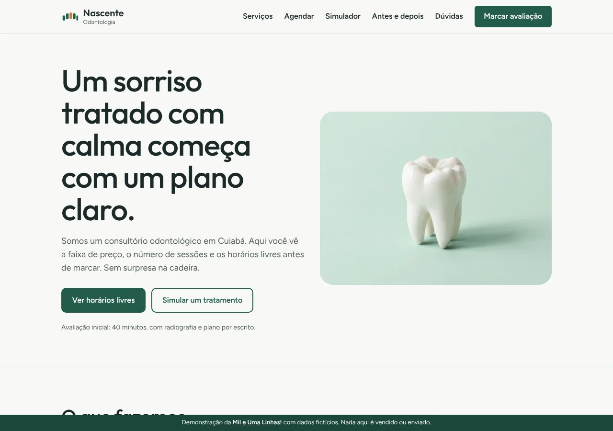
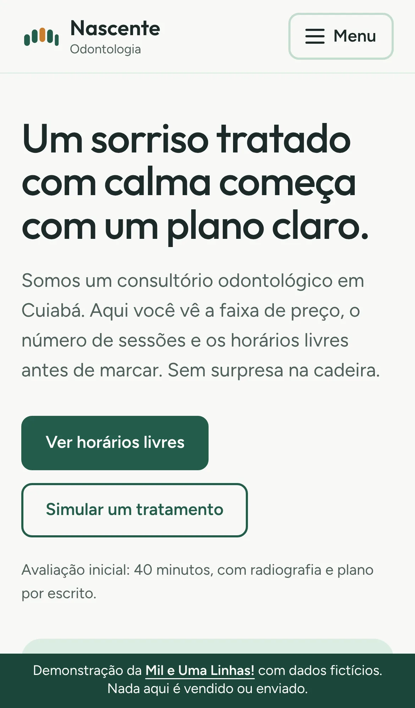
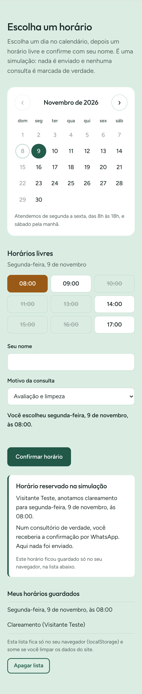
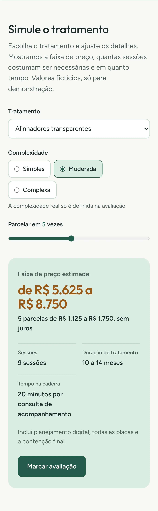
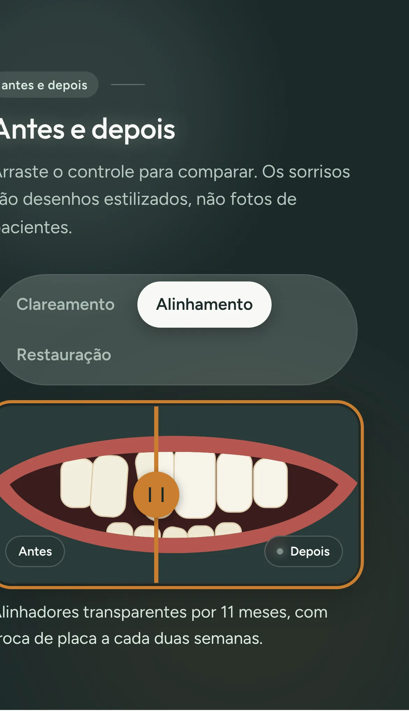

# Nascente Odontologia

Site de demonstração de um consultório odontológico em Cuiabá. Eu, Rodrigo Jr, da [Mil e Uma Linhas!](https://mileumalinhas.com.br), fiz este site para mostrar a dentistas como pode ser o site do consultório deles: bonito, rápido, com identidade própria e com funções que o paciente usa de verdade.

Está no ar em: https://toshiro01001.github.io/dentista/

> **Tudo aqui é fictício.** O consultório, as dentistas, o endereço, o telefone, os horários e os preços foram inventados por mim. Nada é vendido, cobrado ou enviado para ninguém. É uma vitrine do meu trabalho.



## O que o site faz, para quem não entende de tecnologia

É o site de um consultório que **funciona**, não só mostra. Você pode:

1. **Escolher um horário**: um calendário mostra os dias de atendimento, você toca em um dia, vê os horários livres e confirma com seu nome. É uma simulação: a confirmação aparece na tela e fica guardada só no seu navegador.
2. **Simular um tratamento**: escolhe o tratamento (limpeza, clareamento, restauração, alinhadores, implante, canal), ajusta quantos dentes e a complexidade, e o site mostra a faixa de preço, o número de sessões, a duração e o valor das parcelas.
3. **Comparar antes e depois**: arrasta um controle sobre um sorriso desenhado e vê a diferença de um clareamento, de um alinhamento e de uma restauração.
4. **Tirar dúvidas**: perguntas frequentes que abrem ao toque.

Tudo roda no seu celular ou computador, sem internet depois de aberto, sem cadastro, sem cookie.

## Como usar

1. Abra https://toshiro01001.github.io/dentista/ no celular ou no computador.
2. Toque em **Ver horários livres**. Escolha um dia no calendário, depois um horário em branco (os riscados estão ocupados), escreva seu nome e confirme.
3. Toque em **Simulador** no menu. Troque o tratamento e mexa nos controles para ver a faixa de preço mudar.
4. Em **Antes e depois**, arraste a alça laranja (ou use as setas do teclado) e troque o caso nas abas.
5. Em **Dúvidas**, toque em uma pergunta.
6. No fim da página, a seção **Como este site funciona** explica tudo em três níveis.

| Celular | Agenda | Simulador | Antes e depois |
| --- | --- | --- | --- |
|  |  |  |  |

Capturas no computador: [agenda](docs/funcao-agenda-computador.webp), [simulador](docs/funcao-simulador-computador.webp), [antes e depois](docs/funcao-antes-depois-computador.webp).

## Identidade visual, em resumo

O estudo completo está em [`docs/identidade.md`](docs/identidade.md).

- **Nome**: Nascente Odontologia. Água limpa que brota e o começo de um sorriso novo. Nada de "odontoclínica".
- **Paleta**: Esmalte `#F7F8F5` (fundo), Grafite `#1C2A2A` (texto), Cerrado `#245C4C` (cor da marca, botões e links), Hortelã `#DCEDE3` (superfícies de apoio), Mel `#C97E2E` (destaque, um por tela), Pedra `#50605D` (texto secundário). Fugi do azul-clínico genérico: as cores vêm do Cerrado e da porcelana. Todos os pares de texto passam no contraste AA.
- **Fontes**: Outfit nos títulos (geométrica, redonda, lembra um alinhador) e Figtree no corpo (humanista, legível no celular). As duas são variáveis, locais, licença SIL OFL.
- **Imagem forte**: um arco de dentes desenhado em SVG no topo, com um ponto em Mel. Os sorrisos do "antes e depois" também são SVG estilizados, não fotos.
- **Regra**: uma coisa memorável por tela, o resto quieto. Sem rótulos em caixa alta, sem numeração decorativa, sem gradientes de enfeite.

## Como funciona por dentro

O site é um conjunto de três arquivos que o navegador lê e monta sozinho:

- `index.html` tem o texto e a estrutura de todas as seções.
- `css/estilo.css` tem a aparência: cores, fontes, espaçamentos e a versão para celular.
- `js/app.js` tem o comportamento: o menu do celular, o calendário, o simulador e o comparador.

O **calendário** é gerado na hora, a partir da data do aparelho do visitante. Domingos e dias passados ficam desligados. Os horários "ocupados" são sorteados de um jeito fixo para cada dia (um hash da data e da hora), então o mesmo dia mostra sempre os mesmos horários livres, o que deixa a demonstração previsível.

O **simulador** tem uma tabela com faixa mínima e máxima de cada tratamento, se o preço é por dente, quantas sessões costuma ter e quanto tempo dura. Ao mexer em qualquer controle, ele recalcula na hora e aplica um fator pela complexidade e um desconto a partir do terceiro dente.

O **comparador** são dois desenhos sobrepostos. O de "depois" é recortado por uma linha vertical cuja posição vem de um controle deslizante invisível que cobre a imagem inteira. Por isso funciona com mouse, dedo e teclado do mesmo jeito.

Se você confirma um horário, ele fica guardado na memória do seu navegador (`localStorage`), e a página avisa isso. O botão "Apagar lista" limpa.

## Detalhes técnicos

- HTML, CSS e JavaScript puros. Sem framework, sem biblioteca, sem CDN, sem fonte externa, sem analytics.
- `Content-Security-Policy` por `meta`: `default-src 'self'`, sem script inline, sem estilo inline, `connect-src 'none'`, `form-action 'none'`, `object-src 'none'`, `base-uri 'none'`.
- Fontes variáveis Outfit e Figtree em woff2 (subconjunto latino, obtidas do pacote `@fontsource-variable`), com licenças em `fonts/`.
- Acessibilidade: `lang="pt-BR"`, contraste AA em todos os pares de cor, foco visível, link "pular para o conteúdo", calendário como `<table>` com botões rotulados, abas da galeria com `role="tab"` e setas do teclado, comparador operável por `input type="range"`, `aria-live` nos resultados, `prefers-reduced-motion` respeitado. Auditoria com axe-core: zero violações WCAG 2.1 AA em 1280x900 e iPhone 13.
- Disponibilidade determinística por hash FNV-1a de 32 bits da string `AAAA-MM-DD` + hora.
- `404.html` com caminhos absolutos em `/dentista/`, `robots.txt`, `sitemap.xml`, arquivo de verificação do Search Console.

## Como rodar no seu computador

Não precisa instalar nada além do Python, que a maioria dos computadores já tem.

```bash
git clone https://github.com/toshiro01001/dentista.git
cd dentista/..          # fique na pasta que contém a pasta "dentista"
python3 -m http.server 8301
```

Abra http://localhost:8301/dentista/ no navegador. Servir pela pasta de cima faz o endereço ficar igual ao do GitHub Pages, e assim o `404.html` encontra o CSS.

## Testes

O arquivo `tests/site.cjs` abre o site com o Playwright em três telas (1280x900, iPhone 13 e 320 px) e confere: console sem erros, nenhuma rolagem horizontal, nenhum texto cortado, fontes locais carregadas, menu do celular, agendamento completo (dia, horário, nome, confirmação, `localStorage`), validação do nome, contas do simulador, controle deslizante por mouse e teclado, troca de caso, perguntas frequentes e a página 404.

```bash
npm i -g playwright && npx playwright install chromium   # só na primeira vez
python3 -m http.server 8301 &                             # na pasta que contém "dentista"
node dentista/tests/site.cjs                              # CAPTURAS=1 salva as imagens em docs/
```

Resultado da última rodada: tudo passou nas três telas.

## Segurança

Vistoria completa em [`docs/vistoria.md`](docs/vistoria.md). Em resumo: nenhum dado sai do navegador, a CSP bloqueia scripts e conexões externas, o único item guardado é a lista de horários simulados no `localStorage` (com aviso e botão para apagar), nenhuma dependência em produção e nenhum dado real ou segredo no repositório.

## Quem fez

Rodrigo Jr, [Mil e Uma Linhas!](https://mileumalinhas.com.br), Cuiabá. Faço sites e sistemas para empresas e profissionais. Se você é dentista e quer um site assim, com a sua cara e o seu nome, fale comigo.
